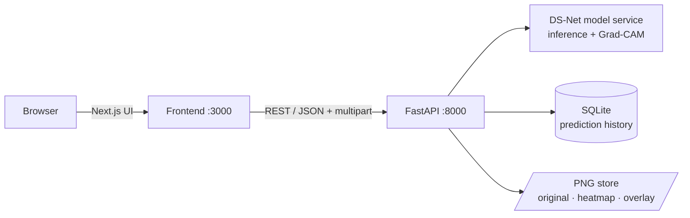

# DS-Net — Explainable Breast Cancer Histopathology Classification

Full-stack system that classifies H&E-stained breast histopathology images as **benign** or **malignant** with a custom residual-attention CNN (**DS-Net**) and explains every prediction with **Grad-CAM** heatmaps.

**Stack:** Keras 3 / TensorFlow · FastAPI · SQLite · Next.js (App Router) · TypeScript · Tailwind CSS · Docker

| Mean accuracy (5-fold CV) | Mean ROC AUC | Deployed model (fold 5) | Parameters |
|---|---|---|---|
| **98.98 % ± 0.62** | **0.9994** | **99.35 %** accuracy | **1.31 M** (5 MB) |

> Research prototype, not a medical device. See [Limitations](#limitations).

---

## Features

- **Upload & analyze**: drag-and-drop or one-click BreakHis samples with known ground truth
- **Explainable output**: Grad-CAM overlay with an adjustable heatmap opacity slider and a side-by-side view
- **Uncertainty handling**: predictions below a configurable confidence threshold (default 75 %) are labelled **Inconclusive** instead of being forced into a class
- **Prediction history**: every result is persisted (SQLite + PNG artefacts) and can be browsed, filtered by label, paginated, reopened and deleted, with aggregate stats
- **Model card page**: per-fold metrics chart, confusion matrix, architecture walkthrough, training setup and stated limitations
- **Production touches**: typed REST API with OpenAPI docs, input validation (type / size / decodability), health endpoint and live status indicator, CORS config, env-based settings, Dockerfiles, docker compose, and pytest suite

## Architecture



### DS-Net model

```
Input 224×224×3
 → Conv(32)+BN+MaxPool → Conv(64)+BN+MaxPool → Conv(128)+BN+MaxPool   (28×28×128)
 → Residual block (2× Conv3×3+BN, identity skip)
 → Attention module: trunk = residual block
                     mask  = MaxPool → residual → bilinear upsample → residual → 1×1 Conv + sigmoid
                     out   = trunk × (1 + mask)
 → Global Average Pooling → Dense(128, ReLU) → Dropout(0.5) → Dense(2, softmax)
```

Trained with Adam (lr 1e-4), batch 64, up to 25 epochs, EarlyStopping + ReduceLROnPlateau, stratified 5-fold CV on a class-balanced, augmented BreakHis-derived set (10,000 images).

### Closed-form Grad-CAM

The Grad-CAM target is the attention-module output that feeds Global Average Pooling. Because the head is `GAP → Dense → ReLU → Dense`, the gradient of the class logit with respect to the feature map has an exact closed form:

```
dz_c/dg = W1 · (1[W1ᵀg + b1 > 0] ⊙ W2[:, c])        g = GAP(A)
α_k     = (dz_c/dg)_k / (h·w)
CAM     = ReLU(Σ_k α_k A_k)
```

The service therefore needs **one forward pass and no autodiff**, and works on any Keras 3 backend. `tests/test_model.py` checks it against a classic `tf.GradientTape` implementation.

## Results (5-fold stratified cross-validation, 2,000 test images per fold)

| Fold | Accuracy | Precision | Recall | F1 | ROC AUC |
|---|---|---|---|---|---|
| 1 | 99.15 % | 99.70 % | 98.60 % | 99.15 % | 0.9998 |
| 2 | 99.55 % | 99.90 % | 99.20 % | 99.55 % | 0.9998 |
| 3 | 98.90 % | 99.39 % | 98.40 % | 98.89 % | 0.9993 |
| 4 | 97.95 % | 98.29 % | 97.60 % | 97.94 % | 0.9983 |
| **5 (deployed)** | **99.35 %** | **99.40 %** | **99.30 %** | **99.35 %** | **0.9997** |
| **Mean** | **98.98 %** | **99.34 %** | **98.62 %** | **98.98 %** | **0.9994** |

Precision / recall / F1 are for the malignant class. Deployed-model confusion matrix: 994 / 6 (benign), 7 / 993 (malignant).

## Quick start

### Docker (recommended)

```bash
docker compose up --build
```

- Web UI: http://localhost:3000
- API docs (Swagger): http://localhost:8000/docs

### Manual

**Backend** (Python 3.10–3.12; TensorFlow has no wheels for newer Python yet)

```bash
cd backend
python -m venv .venv
.venv\Scripts\activate          # macOS/Linux: source .venv/bin/activate
pip install -r requirements-dev.txt
uvicorn app.main:app --reload --port 8000
pytest -v
```

**Frontend** (Node 20+)

```bash
cd frontend
cp .env.example .env.local      # NEXT_PUBLIC_API_URL=http://localhost:8000
npm install
npm run dev
```

## API

| Method | Endpoint | Description |
|---|---|---|
| `GET` | `/api/v1/health` | Service status and whether the model is loaded |
| `GET` | `/api/v1/model` | Model card: architecture, training setup, per-fold metrics |
| `POST` | `/api/v1/predict` | Multipart image upload → label, probabilities, Grad-CAM URLs |
| `GET` | `/api/v1/predictions` | Paginated history (`limit`, `offset`, `label`) |
| `GET` | `/api/v1/predictions/stats` | Totals, label distribution, mean confidence and latency |
| `GET` | `/api/v1/predictions/{id}` | One stored prediction |
| `DELETE` | `/api/v1/predictions/{id}` | Delete a prediction and its images |
| `GET` | `/api/v1/samples` | Bundled BreakHis samples with ground truth parsed from filenames |

Example:

```bash
curl -F "file=@backend/samples/SOB_M_DC-14-2523-400-004.png" http://localhost:8000/api/v1/predict
```

Configuration via environment variables (prefix `DSNET_`): `CONFIDENCE_THRESHOLD`, `MAX_UPLOAD_MB`, `CORS_ORIGINS`, `MODEL_PATH`, `DATA_DIR`. See [backend/.env.example](backend/.env.example).

## Project structure

```
backend/
  app/
    main.py            FastAPI app, routes, dependency injection
    model_service.py   model loading, preprocessing, closed-form Grad-CAM
    storage.py         SQLite history + PNG artefact store
    schemas.py         Pydantic response models
    config.py          env-driven settings
    model_card.json    metrics and metadata served by /api/v1/model
  models/              trained DS-Net checkpoint (.h5)
  samples/             BreakHis demo images
  tests/               API tests (stub model) + real-model tests
frontend/
  src/app/             pages: / · /analyze · /model · /history · /history/[id]
  src/components/      ResultPanel, GradCamViewer, Navbar, ...
  src/lib/api.ts       typed API client
legacy/                original Flask prototype
docker-compose.yml
```

## Limitations

- Augmentation was applied **before** the k-fold split, so augmented copies of the same source image can appear in both training and test folds. The reported metrics are therefore likely optimistic; a **patient-level split** is the correct next evaluation.
- Trained and evaluated on a single dataset (BreakHis); generalisation to other scanners and staining protocols is untested.
- Grad-CAM shows where the model looked, not a clinically validated localisation of tumour tissue.
- Not a medical device; not for diagnostic use.

## Project timeline

- **Dec 2025:** DS-Net designed and trained with stratified 5-fold cross-validation (final-year research project)
- **Jan 2026:** Flask prototype with Grad-CAM (preserved in [`legacy/`](legacy/))
- **Nov 2026:** Rebuilt as a full-stack system: FastAPI backend, Next.js frontend, history, tests and Docker

## Future work

Patient-level cross-validation · external validation on another dataset · stain normalisation · multi-class subtype prediction (8 BreakHis subtypes) · test-time augmentation and calibration · ONNX export for lighter serving.
